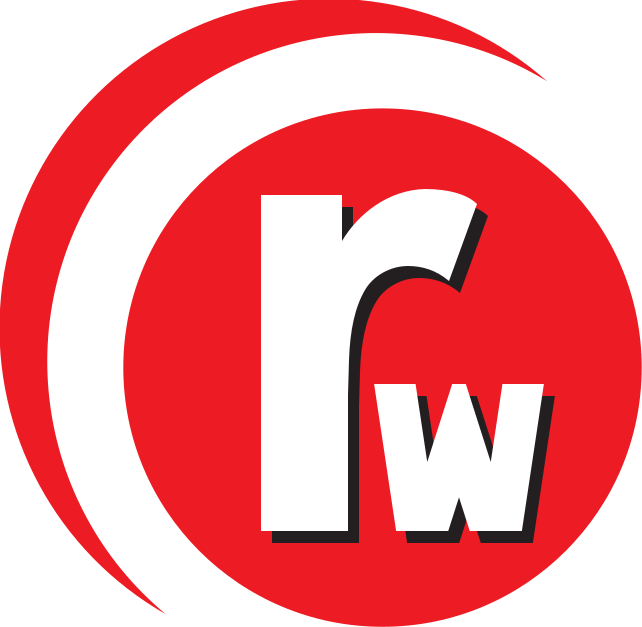
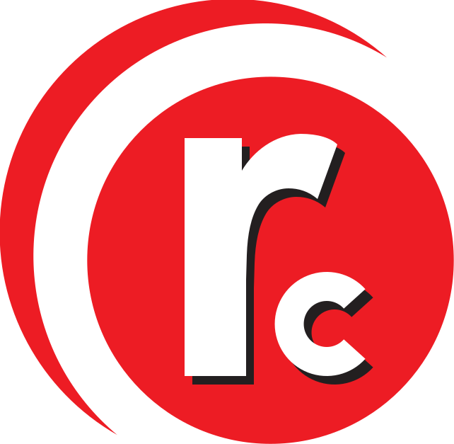
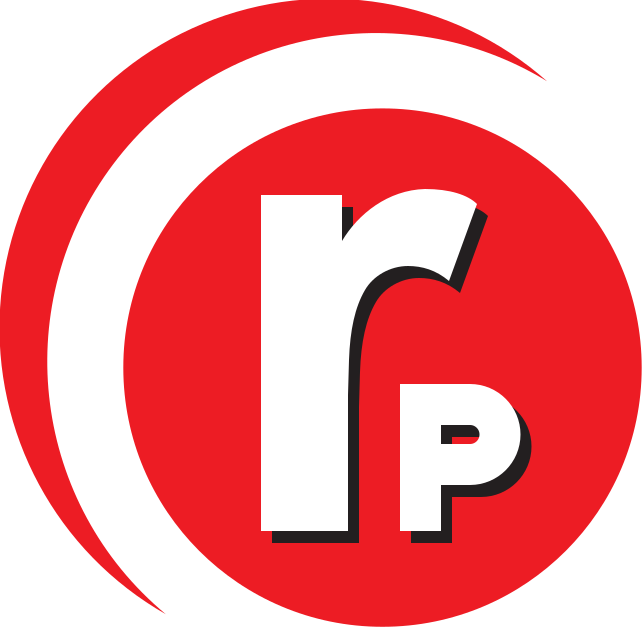

  
  
  

# Raabe Office

**RaabeWrite**, **RaabeCalc** und **RaabePresent**: eine schlanke, freie Office-Suite für
die Raabeschule. Sie sieht aus und verhält sich wie Microsoft 365, damit Schülerinnen,
Schüler und Lehrkräfte ihre gewohnten Arbeitsabläufe aus Word, Excel und PowerPoint
weiter nutzen können.

- **Vertraut:** Menüband, Befehle und Tastenkürzel wie in Microsoft Office, auf Deutsch.
- **Schnell:** kleine Programme, die in unter einer Sekunde starten.
- **Lokal:** kein Konto, keine Cloud, keine Datenübertragung.
- **Kompatibel:** speichert direkt als .docx, .xlsx und .pptx.
- **Für die Schule gemacht:** nur die Funktionen, die im Schulalltag gebraucht werden.
- **Windows und iPad.**

> **Stand:** Schritt 2 abgeschlossen. RaabeWrite kann Text formatieren (Schriftart, -grad,
> fett, kursiv, Farben, Ausrichtung, Einzüge, Abstände, Formatvorlagen) und bricht Zeilen und
> Seiten genau wie Word um. Was RaabeWrite noch nicht bearbeiten kann (Tabellen, Bilder …),
> bleibt beim Speichern unverändert erhalten. Listen, Tabellen und Bilder folgen in Schritt 3.
> Fahrplan: [docs/ROADMAP.md](docs/ROADMAP.md).

## English summary

A lean, offline office suite for the Raabeschule (a Gymnasium in Lower Saxony, Germany)
that mimics the Microsoft 365 look and feel so students can keep their Office muscle
memory after the state stopped funding Microsoft 365. Windows first, iPad close behind.
Design decisions are documented in [docs/DECISIONS.md](docs/DECISIONS.md).

## Lizenz / License

Der Quellcode steht unter der [GNU General Public License v3.0](LICENSE).

**Ausgenommen** sind der Name „Raabeschule“ und das Schullogo samt der davon abgeleiteten
Programmlogos im Ordner [`branding/`](branding/README.md). Wer das Projekt weiterverwendet
(Fork), muss eigene Namen und Logos verwenden.

The source code is licensed under GPL-3.0. The Raabeschule name and logos in `branding/`
are **not** covered by that licence; forks must use their own branding.

Microsoft, Word, Excel, PowerPoint and Microsoft 365 are trademarks of the Microsoft
group of companies. This project is not affiliated with or endorsed by Microsoft.
